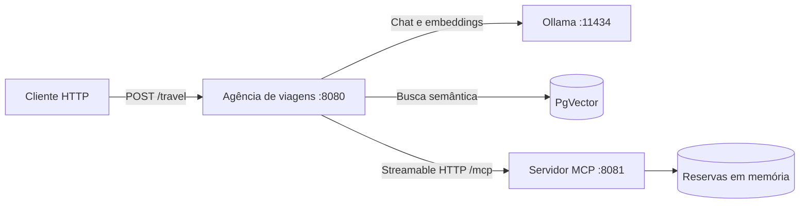

# Agência de Viagens com IA

Projeto de estudo que combina Java, Quarkus, LangChain4j, Ollama, RAG e Model Context Protocol (MCP) para criar um assistente virtual de viagens capaz de consultar informações e operar reservas.

O repositório contém dois serviços:

| Módulo | Responsabilidade | Porta |
| --- | --- | --- |
| [`agencia-viagem-ia`](./agencia-viagem-ia) | API do assistente, integração com o Ollama, RAG, memória, guardrails e cliente MCP | `8080` |
| [`mcp-booking-server`](./mcp-booking-server) | Servidor MCP que publica ferramentas para consultar, cancelar e listar reservas | `8081` |

## Arquitetura



Fluxo principal:

1. O cliente envia uma pergunta em texto puro para a agência.
2. O agente recupera informações dos documentos de pacotes usando RAG.
3. Quando a solicitação envolve reservas, o modelo pode chamar uma ferramenta do servidor MCP.
4. Guardrails analisam tentativas de prompt injection e o tom da resposta.
5. A memória da conversa é separada pelo valor do cabeçalho `X-User-Name`.

## Tecnologias

- Java 25 na aplicação da agência e compatibilidade Java 21 no servidor MCP
- Quarkus
- Quarkus LangChain4j
- Ollama com `qwen3:4b`
- `nomic-embed-text` para embeddings
- PostgreSQL com PgVector, iniciado pelo Quarkus Dev Services no ambiente de desenvolvimento
- Model Context Protocol com transporte Streamable HTTP
- Maven Wrapper

## Pré-requisitos

- JDK 25
- Docker em execução, para o banco PgVector gerenciado pelo Quarkus Dev Services
- [Ollama](https://ollama.com/) em execução na porta `11434`

Baixe os modelos usados pelo projeto:

```bash
ollama pull qwen3:4b
ollama pull nomic-embed-text
```

## Como executar

Inicie primeiro o servidor de reservas:

```bash
cd mcp-booking-server
./mvnw quarkus:dev
```

Em outro terminal, inicie a agência:

```bash
cd agencia-viagem-ia
./mvnw quarkus:dev
```

No Windows, substitua `./mvnw` por `mvnw.cmd`.

## Endpoints da agência

| Endpoint | Descrição | Autenticação simulada |
| --- | --- | --- |
| `POST /travel/v1` | Conversa básica com o assistente | Não |
| `POST /travel/v2` | Assistente com memória por usuário e ferramentas MCP | `X-User-Name` |
| `POST /travel` | Fluxo principal com template, memória, MCP e guardrails | `X-User-Name` |

### Consultar pacotes

```bash
curl -X POST \
  -H "Content-Type: text/plain" \
  -H "X-User-Name: Wallas" \
  -d "Quais pacotes de aventura estão disponíveis?" \
  http://localhost:8080/travel
```

### Consultar uma reserva

```bash
curl -X POST \
  -H "Content-Type: text/plain" \
  -H "X-User-Name: Smith" \
  -d "Consulte os detalhes da reserva 67890." \
  http://localhost:8080/travel
```

### Cancelar uma reserva

```bash
curl -X POST \
  -H "Content-Type: text/plain" \
  -H "X-User-Name: Smith" \
  -d "Por favor, cancele minha reserva 67890." \
  http://localhost:8080/travel
```

O cancelamento compara o cabeçalho com o final do nome do titular. Por isso, a reserva `67890`, cadastrada para `Jane Smith`, deve ser acessada com `X-User-Name: Smith`.

## Ferramentas MCP

| Ferramenta | Descrição |
| --- | --- |
| `getBookingDetails` | Obtém os detalhes de uma reserva pelo ID |
| `cancelBooking` | Cancela uma reserva quando o nome informado corresponde ao titular |
| `listPackagesByCategory` | Lista destinos nas categorias `ADVENTURE` ou `TREASURES` |

O endpoint MCP Streamable HTTP é `http://localhost:8081/mcp`. O endpoint legado SSE também pode ser disponibilizado pelo Quarkus em `/mcp/sse`, mas não é usado pelo cliente deste projeto.

## Reservas de exemplo

| ID | Titular | Destino | Categoria |
| --- | --- | --- | --- |
| `12345` | John Doe | Tesouros do Egito | `TREASURES` |
| `67890` | Jane Smith | Aventura Amazônica | `ADVENTURE` |
| `98765` | Peter Jones | Trilha Inca | `ADVENTURE` |

As reservas são mantidas em memória. Reiniciar o servidor MCP restaura os dados iniciais.

## Estrutura

```text
.
├── agencia-viagem-ia/
│   ├── src/main/java/dev/ia/
│   └── src/main/resources/
├── mcp-booking-server/
│   ├── src/main/java/dev/ia/travel/
│   └── src/main/resources/
└── README.md
```

## Objetivo educacional

Este projeto foi criado para praticar integração de LLMs locais com aplicações Java, recuperação de contexto, function calling por MCP, memória conversacional e guardrails.
